# Author & Company

{ .sfs-brand__logo }

SmartManipulator-X is designed, written and maintained by **Anton Vynohradov** and
published by **SystemFromScratch®**: "Secure embedded systems and compliance-ready
engineering — from concept to certification-ready product."

## Author

**Anton Vynohradov** · [ORCID 0009-0005-6965-0911](https://orcid.org/0009-0005-6965-0911)
{ .sfs-author__name }

Embedded Systems Engineer · Secure Product Architect · Founder of SystemFromScratch®
{ .sfs-author__role }

*Embedded systems built from scratch — from bare metal to Linux, from first schematic to
certification.*

Anton designs and builds reliable, secure embedded products end to end: firmware, board
support packages and drivers, RTOS and Embedded Linux platforms, hardware bring-up, and
the security and compliance work needed to ship them. He is based in Poland and works
remotely worldwide.

| Area | Focus |
| --- | --- |
| Embedded software | Bare-metal, RTOS and Linux firmware in C/C++, built to be maintained for years |
| BSP & drivers | Bootloaders, Zephyr drivers and Linux kernel work for MCUs, SoCs and SoC FPGAs |
| Security & compliance | Secure boot, threat modeling, MISRA C/C++, EU Cyber Resilience Act (CRA) readiness |
| Industries | Industrial IoT, automotive, robotics, medical and consumer electronics |

**Technology:** C · C++ · Python · Zephyr RTOS · FreeRTOS · Embedded Linux · Yocto ·
Buildroot · ARM Cortex-M · STM32 · Microchip FPGA · RISC-V · CAN / ISO-TP · ROS 2 ·
Docker · Git · CI/CD · MISRA C/C++ · EU CRA

For SmartManipulator-X, Anton designed the system architecture, the Robot PC image and
its ROS 2 configuration, the robot description generated from the BCN3D Moveo CAD, the doppelstep
stepper drives, and this documentation.

## SystemFromScratch®

SystemFromScratch® was founded by Anton Vynohradov. The company combines deep embedded
engineering with cybersecurity and certification-focused product development, for teams
in industrial IoT, automotive, robotics, medical and consumer electronics that need a
partner who understands the whole stack — silicon, firmware, operating system and the
regulations that govern them.

| Service | What it covers |
| --- | --- |
| Hardware design with partners | We choose proven, available parts with you, so your product is not tied to one expensive supplier. |
| Hardware bring-up & integration | The first power-on of a new board is where schedules slip. We take it from first boot to a working system. |
| BSP & device drivers | Board support packages, bootloaders and drivers that make your hardware usable and keep timing exact. |
| RTOS & Embedded Linux | A maintained, secure foundation — Zephyr, FreeRTOS or Embedded Linux — instead of home-grown code that only one person understands. |
| Embedded software development | Your devices talk to each other reliably — CAN, RS-485, UART, USB — even when the hardware underneath changes. |
| System integration | Everything works together end to end, and can be tested on a laptop before the hardware exists. |
| Cybersecurity, CRA & compliance | Security and code quality designed in from the start — secure boot, signed updates, MISRA — so audits and EU Cyber Resilience Act conformity are not a last-minute patch. |

SmartManipulator-X is one of the open-source projects in the SystemFromScratch®
portfolio: public engineering work that can be inspected line by line, from the ROS 2
host down to the stepper driver. It is also teaching material for several levels, from
readers who only want to work on robotics algorithms in simulation to engineers who
build and bring up the electronics ([connection guide for beginners](beginners.md)).

## Contact

| Channel | Address |
| --- | --- |
| Website | [systemfromscratch.com](https://systemfromscratch.com) |
| E-mail | [contact@systemfromscratch.com](mailto:contact@systemfromscratch.com) |
| GitHub | [github.com/AntonVynohradov](https://github.com/AntonVynohradov) |
| GitHub organization | [github.com/SystemFromScratch](https://github.com/SystemFromScratch) |
| LinkedIn | [linkedin.com/in/vynohradov](https://www.linkedin.com/in/vynohradov) |
| ORCID | [0009-0005-6965-0911](https://orcid.org/0009-0005-6965-0911) |
| Location | Poland — working remotely worldwide |

Building a robot, bringing up new hardware, or preparing for the Cyber Resilience Act?
Get in touch through [systemfromscratch.com](https://systemfromscratch.com) or by e-mail.

## Support and feedback

- **Bugs and feature requests:** open an issue on
  [GitHub](https://github.com/SystemFromScratch/sfs-smartmanipulator-x-robot/issues).
  Please include the repository commit, the host OS and Docker version, the command you
  ran and its output; for hardware, the firmware variant and the wiring revision.
- **Contributions:** read [Development](development.md) first; keep the documentation
  in step with the change.
- **Commercial support, integration and custom development:** contact SystemFromScratch®
  through [systemfromscratch.com](https://systemfromscratch.com).

## Trademarks and acknowledgements

SystemFromScratch® is a registered trademark. The SystemFromScratch® name and logo are used
in this documentation to identify the publisher of SmartManipulator-X; the Apache License
2.0 grants no rights to use them, and they may not be used to endorse or promote products
derived from SmartManipulator-X without prior written permission.

ROBOTIS, DYNAMIXEL and OpenMANIPULATOR are trademarks of ROBOTIS Co., Ltd. Raspberry Pi
is a trademark of Raspberry Pi Ltd. Waveshare is a trademark of Waveshare Electronics.
STM32 is a registered trademark of STMicroelectronics International N.V. ROS is a
trademark of Open Source Robotics Foundation, Inc. BCN3D is a trademark of BCN3D
Technologies. SmartManipulator-X is not affiliated with or endorsed
by these companies; their names are used only to identify the products the project
builds on.

The mechanical design comes from the
[BCN3D Moveo](https://github.com/BCN3D/BCN3D-Moveo) project (MIT license; the license
text ships with the robot description meshes). The ROS 2 software concepts come from
ROBOTIS [OpenMANIPULATOR-X](https://github.com/ROBOTIS-GIT/open_manipulator) and the
DYNAMIXEL SDK and hardware interface.
