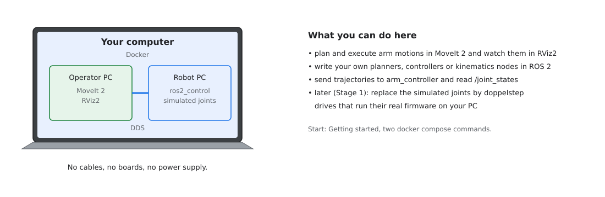
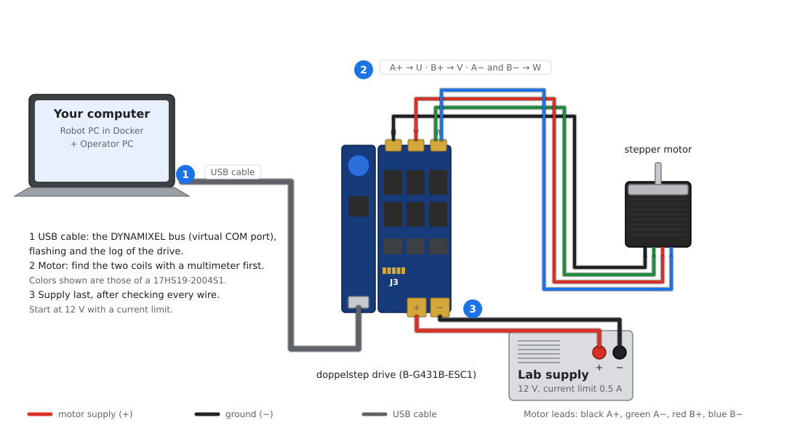
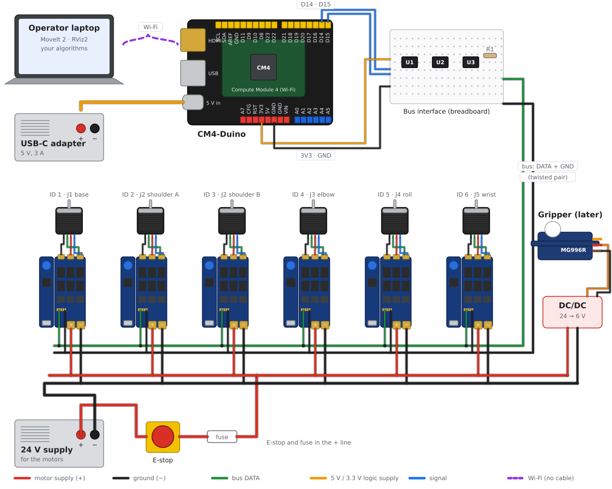
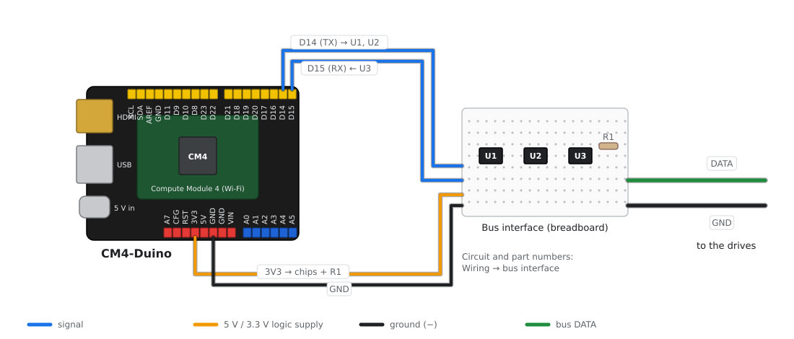
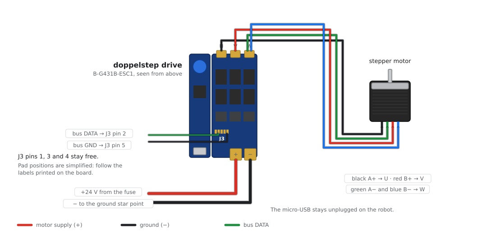

# Connection guide for beginners

This page is for readers who want to work on **robotics algorithms** — motion
planning, kinematics, control, trajectories — and are not (yet) at home in
electronics. It shows in pictures what is connected to what, in three levels.
You can stop at any level: everything above level 1 is optional.

SmartManipulator-X is part of the [SystemFromScratch®](https://systemfromscratch.com/)
portfolio and is also meant for teaching. **All parts are open source:** this
Robot PC repository, the
[Operator PC](https://github.com/SystemFromScratch/sfs-smartmanipulator-x-operator)
and the [doppelstep](https://github.com/SystemFromScratch/sfs-doppelstep) drive
firmware ([documentation](https://systemfromscratch.com/sfs-doppelstep/)) are
published under the Apache License 2.0. Use them, study them, change them.

!!! warning "Educational material, at your own risk"
    This guide is provided as is, without warranty (Apache License 2.0,
    sections 7 and 8). Levels 2 and 3 use mains-powered supplies, 24 V and
    moving mechanics. You build and power the hardware at your own risk:
    follow the [safety rules](#safety-rules) and, if you are unsure, ask
    someone experienced to check your wiring before the first power-up.

> **Status (2026-11-15):** level 1 works today. Levels 2 and 3 describe the
> planned hardware ([project status](status.md)); the pictures are the target
> to build towards. The drawings are simplified: on a real board, follow the
> labels printed next to the pads.

## The three levels at a glance

| Level | What you need | What you can do | State |
| --- | --- | --- | --- |
| 1 · Simulation | One computer with Docker | Plan and execute arm motions, write ROS 2 nodes, test algorithms against simulated joints | Works |
| 2 · One joint on the desk | Level 1 + one drive board, one stepper motor, a lab supply, a USB cable | Run your trajectories on a real motor, see real timing and limits | Planned (Stage 2) |
| 3 · The whole robot | The arm, six drives, the Robot PC board, supplies, a small interface circuit | Run your algorithms on the real arm | Planned (Stages 3–4) |

## Level 1: everything on one computer

Nothing to connect. Two Docker containers play the two computers of the real
system: the **Operator PC** plans motions (MoveIt 2, RViz2), the **Robot PC**
executes them with simulated joints. They talk over ROS 2 exactly as they will
over Wi-Fi on the real robot, so code written here is built to run on the
real arm without changes.

Start with [Getting started](getting-started.md). The interface your algorithms
use — joint names, topics, controllers — is the
[joint contract](robot-pc/index.md#joint-contract) of the Robot PC.

One step further, still without hardware: in the
[tutorial: the whole robot in simulation](tutorial-simulation.md) you move the arm from
RViz2, and six simulated doppelstep drives carry out the motion with the same Robot PC
software that will run on the arm. It assumes no experience with Linux, Docker or ROS.

## Level 2: one joint on the desk

The smallest real hardware: one **drive board** (an ST B-G431B-ESC1 running
the doppelstep firmware) and one **stepper motor**. To your computer the drive
looks like a ROBOTIS DYNAMIXEL smart servo, so the same Robot PC software
drives it.

1. **USB cable** from your computer to the micro-USB socket of the drive. It
   carries the commands, the firmware update and the log.
2. **Motor, four wires.** A stepper motor has two coils (A and B). Find which
   two wires belong together with a multimeter (a few ohms between the two
   wires of one coil, nothing between different coils). Then: A+ to **U**,
   B+ to **V**, A− and B− together to **W**.
3. **Supply last.** A laboratory power supply at 12 V with the current limit
   set low (about 0.5 A) to the **+** and **−** pads. Red is +, black is −.

Before the first motor turns, the drive needs a one-time check described in
the doppelstep [bring-up checklist](https://systemfromscratch.com/sfs-doppelstep/hardware/#bring-up-checklist).

## Level 3: the whole robot

Read the picture from top to bottom:

- **Operator laptop** — your computer with MoveIt 2 and your algorithms. It
  reaches the robot over **Wi-Fi**; no cable.
- **CM4-Duino** — the Robot PC on the robot: a Raspberry Pi Compute Module 4
  on a small carrier board. It has its own **USB-C power adapter** (5 V).
- **Bus interface** — three tiny logic chips on a breadboard that turn the
  two UART pins of the CM4 into the single-wire bus of the drives.
- **The bus** — just **two wires** (DATA and GND, twisted together) from the
  interface to every drive. Each drive has its own number (ID 1–6), so one pair
  of wires reaches all of them.
- **Six drives with six motors** — one drive per motor; the shoulder has two
  motors.
- **24 V supply** — powers the motors through an **emergency stop** button
  and a **fuse**. A small converter makes 6 V for the gripper servo (a later
  project).

### Close-up: the CM4-Duino and the bus interface

Four jumper wires go from the CM4-Duino to the breadboard: **D14** (send),
**D15** (receive), **3V3** (power for the chips) and **GND**. The circuit and
the part numbers are on the [Wiring](hardware/wiring.md#robot-pc-cm4-duino-to-the-bus-interface)
page. The chips come in very small packages; solder each onto a small
SOT-23-to-DIP adapter board so it fits the breadboard.

### Close-up: one drive

Every drive gets the same eight wires: four from its motor, two from the 24 V
supply, two from the bus (**J3 pin 2** = DATA, **J3 pin 5** = GND). The other
J3 pins stay free, and the USB socket stays unplugged on the robot.

## Parts list

| Part | Level | Notes |
| --- | --- | --- |
| Computer with Docker | 1 | Windows (WSL 2), Linux or macOS |
| ST B-G431B-ESC1 | 2: one, 3: six | Drive board, flashed with doppelstep |
| Stepper motors | 2: one, 3: six | The arm's motors are listed in [Joint motors](hardware/wiring.md#joint-motors) |
| Laboratory power supply with current limit | 2 | 12 V for the first tests |
| USB cable (micro-USB) | 2 | Data cable, not a charge-only cable |
| Raspberry Pi CM4 with Wi-Fi + Waveshare CM4-Duino | 3 | The Robot PC ([CM4-Duino](hardware/cm4-duino/index.md)) |
| USB-C power adapter, 5 V ≥ 3 A | 3 | For the CM4-Duino only |
| 24 V power supply | 3 | Size it for the motors; 24 V / 10 A gives comfortable headroom for this arm (rule of thumb, not a measurement) |
| Emergency stop button and fuse holder | 3 | In the + line of the 24 V supply |
| 74LVC1G07, 74LVC1G04, 74LVC1G32, 470 Ω, 100 Ω, 100 pF, 3 × 100 nF | 3 | Bus interface; with SOT-23-to-DIP adapters for the breadboard |
| Breadboard, jumper wires | 3 | Female-to-male jumpers fit the CM4-Duino headers |
| Wire | 3 | Supply and motor wires at least 0.5 mm² (0.75 mm² for the 24 V rail); thin twisted pair for the bus |
| Multimeter | 2, 3 | To find motor coils and to check wiring before power-up |

## Words you will meet

| Word | Meaning here |
| --- | --- |
| Bus | One pair of wires shared by several devices; each answers only to its own ID |
| DATA / GND | The two bus wires: the signal, and the common reference (ground) |
| Ground (GND, −) | The 0 V reference. All grounds of the system meet at one point |
| Drive | The board that turns commands into motor current |
| Coil | A stepper motor has two; each has two wires |
| Supply (PSU) | Turns mains into 24 V (motors) or 5 V (CM4-Duino) |
| DC/DC converter | Turns one DC voltage into another (24 V to 6 V for the servo) |
| E-stop | A big red button that cuts motor power immediately |
| DYNAMIXEL | A family of ROBOTIS smart servos; our drives speak their protocol |

## Safety rules

1. Connect and disconnect wires only with **all supplies off**. A stepper
   unplugged while powered can destroy its drive.
2. Check every connection with the multimeter before the first power-up:
   no short between + and −.
3. First power-up on a lab supply with a low current limit; the 24 V supply
   only when everything works.
4. Keep the emergency stop within reach and hands out of the arm's reach
   while it moves.
5. The logic pins of the CM4-Duino accept only 3.3 V: never connect 5 V or
   24 V to them.

## Next steps

- Algorithms: [Robot PC](robot-pc/index.md) (joint contract, controllers),
  [Operator PC](operator-pc/index.md) (MoveIt 2).
- Hardware details: [Wiring](hardware/wiring.md), [DYNAMIXEL bus](dynamixel/bus.md),
  [doppelstep drives](hardware/doppelstep.md), [CM4-Duino](hardware/cm4-duino/index.md).
- What is done and what comes next: [Project status](status.md),
  [integration plan](plan/doppelstep-cm4.md).
