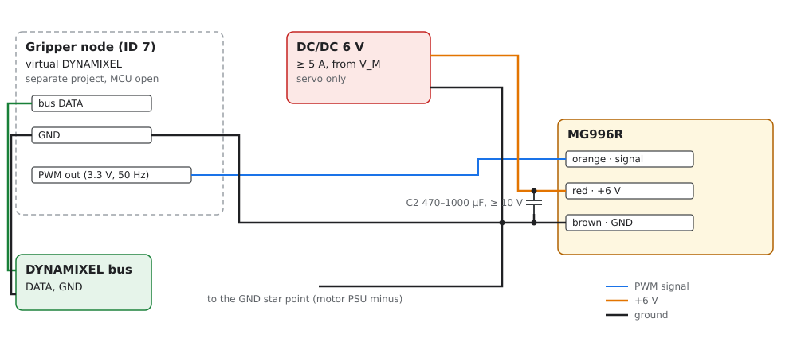

# Gripper servo (MG996R)

The gripper is driven by an MG996R hobby servo. On the bus it will appear as
a virtual DYNAMIXEL device on **ID 7**, so `gripper_controller` and the
[joint contract](../robot-pc/index.md#joint-contract) stay unchanged.

> **Status (2026-11-15):** separate project, not started. It begins after the
> chain Operator PC → Robot PC → doppelstep works (decision D9 of the
> [integration plan](../plan/doppelstep-cm4.md#decisions)). Until then the
> gripper runs on mock hardware. The MCU of the gripper node is open.
>
> **Sources:** Handsontec *MG996R Metal Gear Servo Motor* user guide
> ([`MG996R.pdf`](https://www.handsontec.com/dataspecs/motor_fan/MG996R.pdf)
> on the manufacturer's website, link checked on 2026-11-15). If the link
> stops working, the repository keeps a backup copy
> (`docs/hardware/datasheets/Handsontec_MG996R_user_guide.pdf`, not published
> on this website).

## Datasheet values

| Parameter | Value (Handsontec user guide) |
| --- | --- |
| Operating voltage | 4.8–7.2 V |
| Stall torque | 9.4 kgf·cm at 4.8 V, 11 kgf·cm at 6 V |
| Operating speed | 0.17 s/60° at 4.8 V, 0.14 s/60° at 6 V |
| Running current | 500 mA |
| Stall current | 2.5 A at 6 V |
| Dead band width | 5 µs |
| Control signal | PWM, 20 ms period (50 Hz), 1–2 ms pulse |
| Positions | ~1 ms = one end, 1.5 ms = middle, ~2 ms = other end |
| Rotation | approximately 120° for 1–2 ms |
| Weight, dimensions | 55 g; 40.7 × 19.7 × 42.9 mm |
| Connector | 3-pin, brown = ground (−), red = +V, orange = signal |

Shop listings often say "180°" and "13 kg·cm"; plan with the datasheet values
and measure the real angle per millisecond on the gripper
(see [Calibration](#calibration)).

## Wiring

| Servo wire | Connects to | Notes |
| --- | --- | --- |
| Orange (signal) | PWM output of the gripper node, 3.3 V logic, 50 Hz | Short wire, routed with the ground |
| Red (+V) | +6 V of the servo DC/DC converter | Never from a logic supply: the servo draws up to 2.5 A |
| Brown (−) | Minus of the servo DC/DC converter and the GND star point | The servo current must not flow through the bus ground |

| Item | Specification |
| --- | --- |
| Converter | DC/DC from V_M to **6 V, ≥ 5 A**, for the servo only; stay within 4.8–7.2 V |
| Bulk capacitor | Low-ESR electrolytic, 470–1000 µF, ≥ 10 V, at the servo connector, against dips at start and stall (project practice, not from the datasheet) |
| Wires | +6 V and − at least 0.5 mm² |
| Gripper node | DATA and GND from the [DYNAMIXEL bus](../dynamixel/bus.md), its own logic supply (open, part of the gripper project) |

### Signal level

The gripper node drives a 3.3 V signal. Most MG996R servos switch reliably
at 3.3 V, but the datasheet gives no input threshold. If the servo jitters
although the pulses are clean on an oscilloscope, add a one-way level
shifter such as a 74AHCT125 powered from 5 V. Never pull the signal up to
the 6 V servo supply: that would drive more than 3.3 V into the MCU pin.

## Behavior the gripper node must provide

| Topic | Requirement |
| --- | --- |
| Protocol | DYNAMIXEL Protocol 2.0 device on ID 7, same bus parameters as the drives |
| Pulse | 50 Hz, 1000–2000 µs, ≥ 1 µs resolution (servo dead band 5 µs) |
| Torque off | No pulses: the servo is limp |
| Start | The servo position after power-up is unknown; the first Torque ON moves at full speed to the start position |
| Speed | Software ramp of the pulse width (Profile Velocity), because the servo itself always moves at full speed |
| Limits | Position limits stored in the device, set from the calibration |

## Calibration

The servo has no position feedback. Find the end positions by hand:

1. Low profile velocity, Torque ON.
2. Move in steps of 1–2° towards *closed* until the jaws just touch, then back
   off by 2–3°. Note the angle. Do not hold the servo against a stop: it then
   draws the stall current of 2.5 A and heats up.
3. Do the same towards *open*.
4. Store both values as position limits.

## Safety

1. Plug or unplug the servo only with the 6 V converter off.
2. Only 3.3 V signals from the gripper node; no pull-up to the servo supply.
3. Torque OFF removes the pulses: the gripper may open under load.
4. Keep hands out of the gripper at the first Torque ON after power-up.
