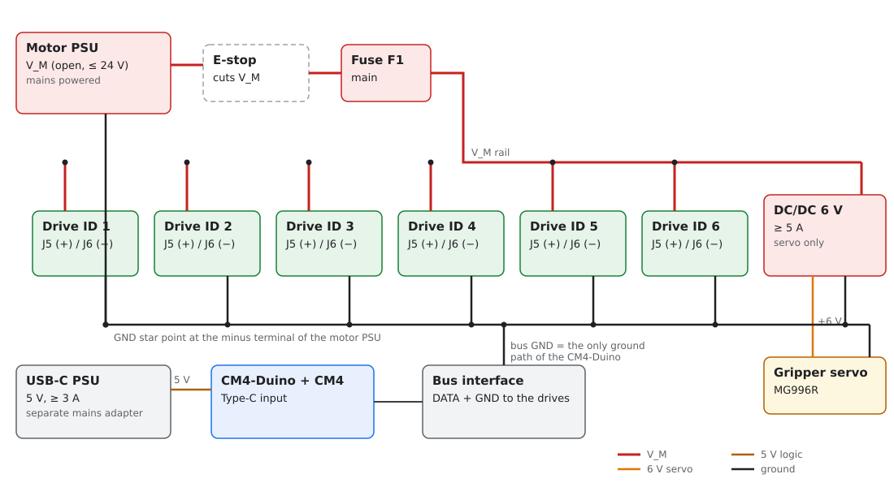
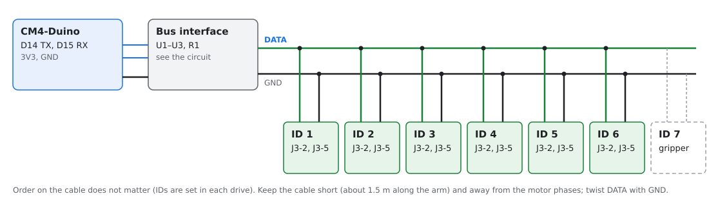
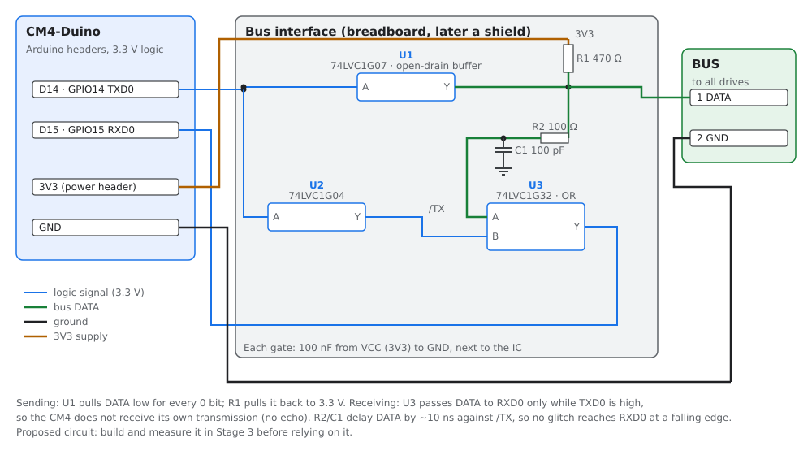
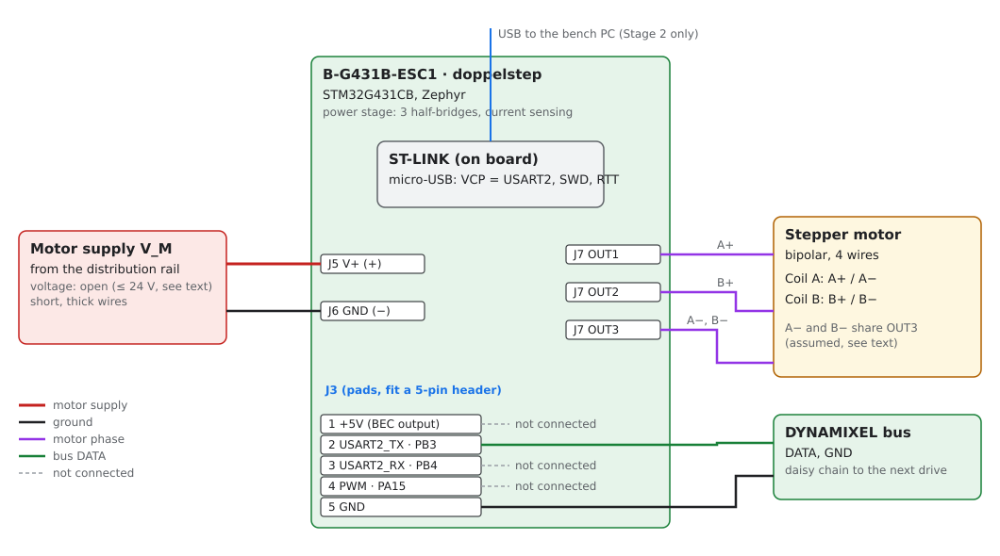

# Wiring

How the Robot PC board, the joint drives, the gripper servo and the supplies
are connected. The [DYNAMIXEL bus](../dynamixel/bus.md) page explains the bus
itself; this page is the wiring reference to build from. New to electronics?
Start with the [connection guide for beginners](../beginners.md).

> **Status (2026-11-15):** proposed wiring, nothing is built yet. Pins of the
> CM4-Duino come from the [Waveshare documentation](cm4-duino/index.md), the
> drive connectors from the ST B-G431B-ESC1 schematic (MB1419 rev. C-01), and
> the motor and supply data from the doppelstep
> [Hardware and bring-up](https://systemfromscratch.com/sfs-doppelstep/hardware/) page, which is authoritative for the
> drive. Items marked **to confirm** must be checked before power is applied.

## Overview

| Rule | Why |
| --- | --- |
| One ground star point at the minus terminal of the motor PSU | Motor currents must not flow through the bus ground or the CM4-Duino |
| The CM4-Duino has its own 5 V supply and reaches ground only through the bus GND | No ground loop through two supplies |
| Bus DATA and GND twisted together, away from the motor phase wires | The stepper phases switch at 20 kHz with steep edges |
| Plug or unplug motors, servo and bus only with all supplies off | Hot-plugging a stepper can destroy the power stage; the bus pins are not protected |

## Robot PC: CM4-Duino to the bus interface

| CM4-Duino pin | Signal | Interface |
| --- | --- | --- |
| D14 (GPIO14, TXD0) | UART transmit | U1 input A, U2 input A |
| D15 (GPIO15, RXD0) | UART receive | U3 output Y |
| 3V3 (power header) | 3.3 V supply of the interface and the pull-up | U1–U3 VCC, R1 |
| GND | Ground | U1–U3 GND, BUS pin 2 |

| Part | Value | Function |
| --- | --- | --- |
| U1 | 74LVC1G07 | Open-drain buffer: pulls DATA low while TXD0 is low |
| U2 | 74LVC1G04 | Inverter: /TX |
| U3 | 74LVC1G32 | OR of DATA and /TX: RXD0 follows DATA only while TXD0 is high, so the CM4 does not receive its own packets |
| R1 | 470 Ω to 3V3 | Bus pull-up, the only one on the bus; sized for about 1.5 m of cable at 1 Mbps |
| R2, C1 | 100 Ω, 100 pF | Delay DATA by about 10 ns against /TX, so no glitch reaches RXD0 at a falling edge |
| C | 100 nF per IC | Decoupling |

The drives configure their bus pin as open-drain in half-duplex mode, so all
devices only pull DATA low and R1 pulls it high: no device can drive against
another. **To confirm in Stage 3:** rise time on the full cable at 1 Mbps (R1
may need to go down to 330 Ω), and that the OR gate really suppresses the
echo (`dynamixel_sdk` ping with a logic analyzer on TXD0, DATA and RXD0).

Why not a direction GPIO: switching a GPIO from Linux after the last stop bit
is too slow and too jittery for the Return Delay Time of the drives. The
circuit above needs no direction signal at all.

## Joint drives: B-G431B-ESC1

### Connectors

| Connector | Pin | Net (schematic) | Connect to |
| --- | --- | --- | --- |
| J5 | + | V+ | Motor supply V_M (+) |
| J6 | − | GND | Motor supply ground |
| J7 | OUT1 | Leg U (TIM1_CH1/CH1N, PA8/PC13) | Motor A+ |
| J7 | OUT2 | Leg V (TIM1_CH2/CH2N, PA9/PA12) | Motor B+ |
| J7 | OUT3 | Leg W (TIM1_CH3/CH3N, PA10/PB15), shared | Motor A− **and** B− |
| J3 | 1 | +5V (output of the on-board 5 V regulator) | **Not connected** |
| J3 | 2 | USART2_TX, PB3 | Bus DATA |
| J3 | 3 | USART2_RX, PB4 | Not connected (half-duplex uses PB3 only) |
| J3 | 4 | PWM, PA15 | Not connected |
| J3 | 5 | GND | Bus GND |
| ST-LINK USB | – | ST-LINK/V2-1 on the detachable part of the board | Bench PC only: VCP (USART2 = the DYNAMIXEL bus), SWD flashing, RTT log |

Notes:

- J3, J5, J6 and J7 are solder pads on the board. Solder a 5-pin header to J3
  and wires of sufficient cross-section to J5/J6/J7.
- USART2 on PB3/PB4 is also the ST-LINK virtual COM port (through 0 Ω
  resistors R23/R24 on the ST-LINK part of the board). That is why the bench
  link of Stage 2 and the bus of the arm use the same UART. On the arm, leave
  the ST-LINK USB unplugged.
- Motor coils: doppelstep uses a shared-leg topology, each coil between its
  own leg (U or V) and the common leg W
  ([motor wiring](https://systemfromscratch.com/sfs-doppelstep/hardware/#motor-wiring)). Leg W carries the sum of both
  coil currents, up to √2 times the phase current: use the same wire
  cross-section as for the supply. Before torque is enabled, doppelstep tests
  each coil and refuses torque if a coil is open, shorted or miswired.
- **Motor supply 24 V:** the doppelstep firmware accepts 10–28 V and is tuned
  for 24 V ([supply and bus voltage](https://systemfromscratch.com/sfs-doppelstep/hardware/#supply-and-bus-voltage)).
  The board input also has a TVS diode SMM4F26A (26 V stand-off) across V+,
  so do not go above 24 V nominal. First runs on a laboratory supply at 12 V
  with a current limit.
- Before the first motor is connected, run the doppelstep
  [bring-up checklist](https://systemfromscratch.com/sfs-doppelstep/hardware/#bring-up-checklist): dead time measured
  first, then offsets, current polarity, current loop, motion, protection.
- Per-drive settings (ID, baud rate, direction) are listed on the
  [doppelstep drives](doppelstep.md#per-drive-configuration) page.

### Joint motors

| ID | Joint | Motor | Rated current | Notes |
| --- | --- | --- | --- | --- |
| 1 | `j1_base` | NEMA 17, 17HS19-2504S | 2.5 A | |
| 2 | `j2_shoulder` (a) | NEMA 23, 23HS2430 | 3.0 A | |
| 3 | `j2_shoulder` (b) | NEMA 23, 23HS2430 | 3.0 A | Faces motor (a): runs mirrored (Drive Mode reverse) |
| 4 | `j3_elbow` | NEMA 17, 17HS19-1684S-PG5 | 1.68 A | Planetary gearbox 5.18:1 (57/11), at most 2 N·m at the output |
| 5 | `j4_forearm_roll` | NEMA 17, 17HS13-0404S1 | 0.4 A | Never run it with the current setting of a larger motor |
| 6 | `j5_wrist` | NEMA 14, 14HS20-1504S | 1.5 A | |

Set the run current of every drive to the rated current of its motor before
the first move ([doppelstep configuration](https://systemfromscratch.com/sfs-doppelstep/configuration/)). Wire colors
differ between the motor types and batches; identify the two coils with an
ohmmeter (a few ohms within a coil, open between coils) instead of trusting
colors. A swapped coil end only reverses the current sign; step 3 of the
doppelstep bring-up checklist detects it.

## Gripper servo

The gripper is a separate project; its wiring is on the
[gripper servo](gripper-servo.md) page.

## Power-up order and checks

1. All supplies off. Check with a multimeter: no short between V_M and GND at
   each drive; no connection between bus DATA and V_M.
2. CM4-Duino on (5 V USB-C). Check DATA idles at 3.3 V.
3. Motor supply on (E-stop released). Drives start with torque off; a supply
   below 10 V or above 28 V trips the doppelstep
   [protection](https://systemfromscratch.com/sfs-doppelstep/protection/).
4. Ping every ID from the Robot PC before enabling torque.

Power-down in reverse order. An emergency stop that cuts V_M is planned and
must exist before the full arm moves ([project status](../status.md)).
