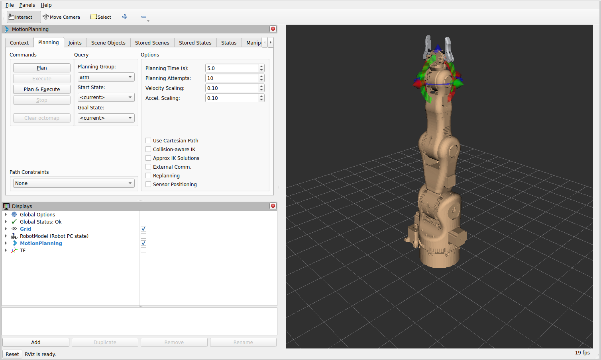

# Tutorial: the whole robot in simulation

This tutorial is for you if you have **never worked with ROS, Docker or Linux**. At the
end you move the SmartManipulator-X arm on your screen with the mouse, and the motion is
carried out by the real software of the robot: the motion planner, the robot computer and
the firmware of six motor drives. Only the motors themselves are simulated.

You need no electronics, only a computer. Every command is given in full: copy it,
paste it, press Enter.

**Time:** about one hour the first time (mostly waiting for downloads), about five
minutes every time after that.

## What you will start

The real robot consists of three kinds of parts. In this tutorial all of them run on
your computer, each in its own box (a *container*):

```text
 Operator PC                    Robot PC                         Six drives (doppelstep)
 MoveIt 2 + RViz2               ros2_control                     firmware of the motor drives
 "where should the arm go?" --> "move each joint like this" ---> "turn the motor"
 you click here                 virtual DYNAMIXEL bus  <-------  answer: "I am here now"
```

| Part | On the real robot | In this tutorial |
| --- | --- | --- |
| **Operator PC** | your laptop | a container with MoveIt 2 (plans motions) and RViz2 (the window you click in) |
| **Robot PC** | a small computer on the robot (CM4-Duino) | a container with `ros2_control` (turns a motion into commands for every joint) |
| **Drives** | six boards, one per motor | six containers, each running the unchanged drive firmware; the motor is a computer model |

## Words used here

| Word | Meaning |
| --- | --- |
| Terminal | A window in which you type commands. Here always the **Ubuntu** terminal, never PowerShell |
| WSL | *Windows Subsystem for Linux*: a Linux (Ubuntu) inside Windows |
| Docker | Runs programs in *containers*: boxes with everything a program needs, so you install nothing else |
| Image | The template of a container. It is built (or downloaded) once, then started many times |
| Repository | A project folder with its full history, downloaded with `git clone` |
| ROS 2 | The robot software framework; the Operator PC and the Robot PC talk through it |

## Part A: prepare your computer (once)

### A1. Install WSL with Ubuntu

On Linux you can skip this step. On Windows 10 or 11:

1. Right-click the Start button and open **Terminal (Admin)** or **Windows PowerShell
   (Admin)**.
2. Type:

    ```powershell
    wsl --install -d Ubuntu-24.04
    ```

3. Restart the computer when asked. After the restart an Ubuntu window opens and asks for
   a **user name** and a **password**. Choose both and remember the password: Ubuntu
   asks for it when you install something. While you type it, nothing appears; that is
   normal.

Check it in PowerShell:

```powershell
wsl --version
```

The output must contain a line `WSLg version`. If the command is unknown, your WSL is
too old: run `wsl --update` and try again.

!!! tip "How to open the Ubuntu terminal later"
    Press the Windows key, type **Ubuntu** and open *Ubuntu 24.04*. In it, paste with
    **right-click** or **Ctrl+Shift+V** (Ctrl+V does not work there).

### A2. Install Docker Desktop

1. Download Docker Desktop from [docker.com](https://www.docker.com/products/docker-desktop/)
   and install it with the default settings (keep *Use WSL 2* switched on).
2. Start Docker Desktop. Open **Settings → Resources → WSL integration**, switch on
   **Ubuntu-24.04**, then **Apply & restart**.
3. Close the Ubuntu terminal and open a new one. Check:

    ```bash
    docker version
    ```

    The output must contain a **Client** part and a **Server** part. If it says
    `docker: command not found`, repeat step 2.

Docker Desktop must be running whenever you use the robot software (its whale icon is in
the taskbar).

### A3. Download the three repositories

In the Ubuntu terminal:

```bash
mkdir -p ~/smx
cd ~/smx
git clone https://github.com/SystemFromScratch/sfs-doppelstep.git doppelstep
git clone https://github.com/SystemFromScratch/sfs-smartmanipulator-x-robot.git SmartManipulator-X-Robot-PC
git clone https://github.com/SystemFromScratch/sfs-smartmanipulator-x-operator.git SmartManipulator-X-Operator-PC
ls
```

`ls` must list three folders: `doppelstep`, `SmartManipulator-X-Robot-PC` and
`SmartManipulator-X-Operator-PC`. Keep exactly these names: the Operator PC looks for the
Robot PC folder next to it under that name.

!!! note "Why in Ubuntu and not on drive C:"
    Folders in Ubuntu (`~` is your Ubuntu home folder) are much faster for Docker than
    folders on the Windows drive, and the files keep Linux line endings.

### A4. Let RViz2 open its window

RViz2 runs inside a container and has to reach your screen. Create a small settings
file for the Operator PC:

```bash
cd ~/smx/SmartManipulator-X-Operator-PC
printf 'SMX_X11_DIR=/mnt/wslg/.X11-unix\nSMX_WSLG_DIR=/mnt/wslg\n' > docker/.env
cat docker/.env
ls /mnt/wslg/.X11-unix
```

`cat` shows the two lines you wrote; the last command must show `X0`. This works on
Windows 10 and 11, as long as you start the Operator PC from the Ubuntu terminal.

On a **Linux desktop** use the X11 settings instead, described in the Operator PC
documentation under
[GUI on a Linux desktop](https://systemfromscratch.github.io/sfs-smartmanipulator-x-operator/docker/#gui-on-a-linux-desktop-x11).

### A5. Build the drive firmware

The drive firmware is built once with the Zephyr tools, which come in their own image.
This is the longest step (several gigabytes to download):

```bash
cd ~/smx/doppelstep
docker compose build
docker compose run --rm zephyr bash scripts/west-init.sh
docker compose run --rm zephyr west build -b native_sim/native/64 -s app -d build-native
ls build-native/zephyr/zephyr.exe
```

**Expected:** the last line prints `build-native/zephyr/zephyr.exe`. That file is the
drive firmware as a Linux program.

The Robot PC and the Operator PC images are built automatically the first time you start
them in Part B.

## Part B: start the robot (every time)

You need **four Ubuntu terminals** side by side. Open them now (Windows key, *Ubuntu
24.04*, four times) and give each one its job:

| Terminal | Job | Stays open with a running log |
| --- | --- | --- |
| 1 | the six drives | no, it finishes at once |
| 2 | Robot PC | yes |
| 3 | Operator PC with RViz2 | yes |
| 4 | checks | no |

### B1. Terminal 1: start the six drives

```bash
cd ~/smx/doppelstep
for i in 1 2 3 4 5 6; do
  docker compose run -d --rm --name dxl$i -p $((5554+i)):5555 zephyr \
    python3 tools/sim/run_native.py run --tcp 5555 --link /tmp/ttyDXL -- --flash=/tmp/flash.bin
done
docker ps --filter name=dxl --format '{{.Names}}  {{.Status}}'
```

**Expected:** six lines `dxl1 … dxl6  Up …`. The drives now run in the background. They
all start with the factory ID 1; the Robot PC gives each one its own ID in the next step.

If you see `The container name "/dxl1" is already in use`, the drives still run from
last time. That is fine: go on with B2.

### B2. Terminal 2: start the Robot PC

```bash
cd ~/smx/SmartManipulator-X-Robot-PC
docker compose -f docker/docker-compose.yml -f docker/docker-compose.sil.yml up --build robot_pc
```

The first time this builds the image (10–20 minutes). Then the log scrolls. Wait for
this line:

```text
Configured and activated gripper_controller
```

Leave the terminal open. On the way you see ten lines `FastSyncRead TxRx failed
(attempt n/10)`: that is **expected** (the Robot PC tries a faster read mode once, the
simulated drives do not offer it yet, so it switches to the normal one).

### B3. Terminal 4: check that the Robot PC works

```bash
cd ~/smx/SmartManipulator-X-Robot-PC
docker compose -f docker/docker-compose.yml run --rm probe smx_smoke_test.sh
```

The test moves the arm a little and back, through the drives. **Expected:** `PASS` on
the last line. If it fails, see [When something goes wrong](#when-something-goes-wrong).

### B4. Terminal 3: start the Operator PC

```bash
cd ~/smx/SmartManipulator-X-Operator-PC
docker compose -f docker/docker-compose.yml up --build operator_pc
```

The first time this builds the image (10–20 minutes). Wait for the line
`You can start planning now!`. A window **RViz** opens on your Windows desktop
(sometimes behind the other windows: look in the taskbar):



## Part C: move the arm

In RViz, on the **Planning** tab of the *MotionPlanning* panel:

1. **Planning Group:** `arm` (already selected).
2. **Goal State:** open the list and choose **ready**. An orange arm shows where the arm
   should go; the grey arm is where it is now.
3. Click **Plan & Execute**.

The arm bends forward. It moves slowly on purpose (*Velocity Scaling* 0.10). What
happened: MoveIt planned a path without collisions, the Robot PC turned it into commands
for every joint, and the six drive firmwares followed them and reported their positions
back.

Now choose **Goal State: home** and click **Plan & Execute** again: the arm stands up.

Things to try next:

- Drag the coloured arrows at the gripper to set your own goal, then **Plan & Execute**.
  If the orange arm stops following, the goal is out of reach.
- Set **Planning Group** to `gripper` and choose **closed** or **open**. (The gripper is
  not driven by a doppelstep drive yet; it is simulated more simply.)
- All RViz features are explained in
  [Planning in RViz2](https://systemfromscratch.github.io/sfs-smartmanipulator-x-operator/rviz/)
  of the Operator PC documentation.

### Look at the numbers (optional)

In terminal 4, the joint positions the drives report, in radians:

```bash
cd ~/smx/SmartManipulator-X-Robot-PC
docker compose -f docker/docker-compose.yml run --rm probe \
  bash -c 'ros2 topic echo --once /joint_states --field position'
```

After **ready** the values are close to `0, 0.5, 0.8, 0, 0.6` for `j1_base` … `j5_wrist`
(the first value is the gripper).

## Part D: stop everything

1. In terminals 3 and 2: press **Ctrl+C** and wait until the prompt comes back.
2. In any terminal:

    ```bash
    cd ~/smx/SmartManipulator-X-Operator-PC
    docker compose -f docker/docker-compose.yml down
    cd ~/smx/SmartManipulator-X-Robot-PC
    docker compose -f docker/docker-compose.yml -f docker/docker-compose.sil.yml down
    docker stop dxl1 dxl2 dxl3 dxl4 dxl5 dxl6
    ```

Next time start again with Part B.

## When something goes wrong

| What you see | Why | What to do |
| --- | --- | --- |
| `docker: command not found` in Ubuntu | Docker Desktop is not running, or its WSL integration is off | Start Docker Desktop; step A2 |
| `wsl` opens a window that closes at once, or errors about `bash` | Windows opened the `docker-desktop` system instead of Ubuntu | Open *Ubuntu 24.04* from the Start menu, or once in PowerShell: `wsl --set-default Ubuntu-24.04` |
| Terminal 2 stays at `waiting for the virtual bus …` | The drives do not run | Step B1 in terminal 1 |
| Terminal 2: `no drive answers on ID n` | One drive kept an old ID | `docker stop dxl1 dxl2 dxl3 dxl4 dxl5 dxl6`, then B1 and B2 again |
| Terminal 3: `network smx_net declared as external, but could not be found` | The Operator PC was started before the Robot PC | Start the Robot PC first (B2) |
| Terminal 3: `could not connect to display :0` | RViz cannot reach your screen | Step A4; start terminal 3 from Ubuntu, not from PowerShell |
| `Address already in use` | An old container still holds its address | Part D, then start again |
| **Plan & Execute** ends with *failed* or the arm does not move | The Robot PC is not up, or a goal out of reach | Wait for `gripper_controller` in terminal 2; try the named goals **ready** and **home** |
| Everything is very slow | Little memory for Docker | Close other programs; Docker Desktop *Settings → Resources* |

## What you have just run

- The **Operator PC** and the **Robot PC** talked over ROS 2 on a Docker network, as they
  will over Wi-Fi on the real robot. Code you write for the Operator PC runs on the real
  arm later without changes.
- The **Robot PC** used the same software it will use on the arm: `ros2_control` with the
  ROBOTIS DYNAMIXEL hardware interface.
- The **drives** were the real doppelstep firmware, compiled as a Linux program with a
  simulated motor, joined into one bus by a small tool of the Robot PC.

This setup is called **SIL** (software in the loop). How it is built and how to judge its
log in detail: [Tutorial: checking SIL step by step](robot-pc/sil-tutorial.md). How the
connections of the real robot will look: [Connection guide for beginners](beginners.md).
